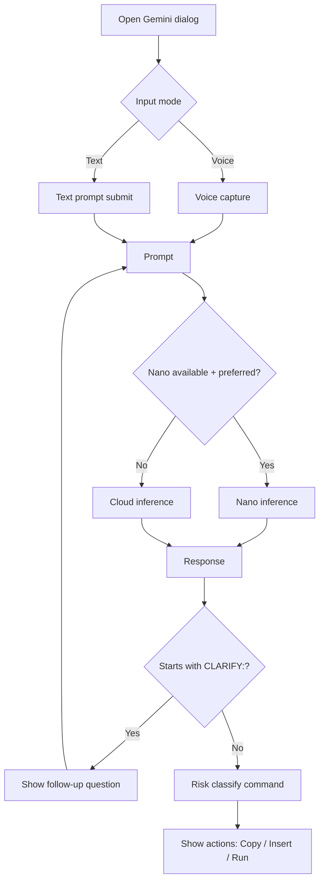
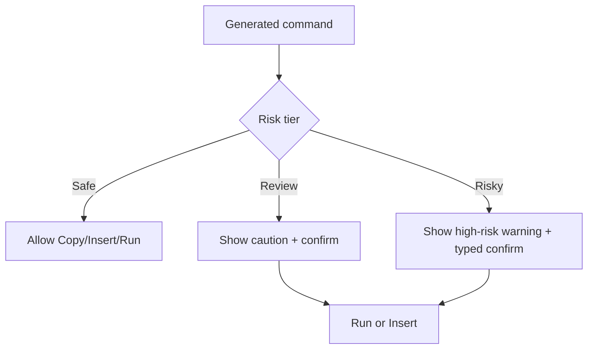
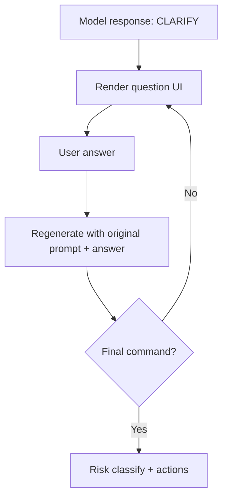

# Gemini v0.5.0 Plan

This document proposes concrete improvements for Gemini-related functionality and user flows in `v0.5.0`.

## Goals

- Make Gemini more reliable in real-world usage (voice noise, partial connectivity, model fallback).
- Make Gemini safer for shell command generation.
- Make Gemini interactions easier to continue and reuse over time.

## Current gaps (observed)

- Voice entry is blocked when cloud auth is missing, even if Gemini Nano is available.
- `CLARIFY:` responses are not handled as a conversational follow-up step.
- Output is treated as a plain command string without risk classification.
- Transcript is in-memory for the session only and does not survive app/process restart.
- Voice is the primary entry path; no first-class text prompt path in the dialog.

## Proposed scope

### P0 — Must ship

1) Nano-first access gating
- Allow Gemini usage when Nano is `AVAILABLE`, even if cloud API auth is absent.
- Keep existing cloud fallback for non-Nano devices.

2) Clarification loop support
- Detect output starting with `CLARIFY:`.
- Render a dedicated follow-up question state in the Gemini dialog.
- Let the user answer in-place and regenerate command.

3) Command safety layer
- Add lightweight command risk scoring before presenting final actions.
- Tiers:
  - `Safe`: read-only/common navigation
  - `Review`: state-changing but bounded
  - `Risky`: destructive/high-impact patterns
- Require an explicit confirmation step for `Risky` before insert/run.

### P1 — Should ship

4) Text prompt mode in Gemini dialog
- Add text input + send button in dialog alongside voice button.
- Add one-tap "reuse last prompt" action.

5) Persistent transcript
- Store transcript entries locally with timestamp, model/backend, prompt, response, and user action.
- Reload transcript into Gemini dialog on launch.

6) Better action affordances
- Keep `Copy`.
- Add `Insert to Terminal`.
- Add `Run Now` with explicit confirmation path for `Review`/`Risky` tiers.

### P2 — Nice to have

7) Context-aware prompting (opt-in)
- Optional toggles for including active host label, last known cwd, and recent terminal output snippet.
- Default off; show clear privacy explanation.

8) Routing observability
- Show backend used (`Nano`, `Cloud Flash`, `Cloud Pro`) and fallback reason.
- Show request latency in transcript metadata.

## UX flow updates

## 1) Quick command flow



## 2) Safe execute flow



## 3) Clarification flow



## Acceptance criteria

### P0 acceptance criteria

- Gemini dialog can start and complete command generation on Nano-only devices without cloud auth configured.
- If model returns `CLARIFY: ...`, the UI renders a follow-up prompt state and users can continue to final command without leaving dialog.
- Every generated command is assigned `Safe`/`Review`/`Risky` tier and shown in UI.
- `Risky` commands cannot be run directly without explicit confirmation.

### P1 acceptance criteria

- Users can submit prompt by text input in dialog, not only voice.
- Transcript persists across process death and app restart.
- Actions available on final command: `Copy`, `Insert to Terminal`, `Run Now`.

## Technical notes

- Reuse current prompt contract in `GeminiClient` and `GeminiNanoClient` (`CLARIFY:` support already present).
- Keep safety checks deterministic and local (rule-based), independent of model output confidence.
- Keep transcript storage in app-local persistence; treat it as potentially sensitive and provide a clear-clear action.

## Suggested tasks (implementation order)

1. Fix Nano-first gating in main Gemini entry path.
2. Add response parser: `clarify` vs `command`.
3. Implement command risk classifier + confirmation component.
4. Add text prompt controls in Gemini dialog.
5. Persist transcript and load on dialog open.
6. Add `Insert` and `Run` action handlers.
7. Add optional context toggles (P2).

## Changelog candidate snippet

```markdown
### Added
- Added Gemini clarification flow for ambiguous requests (`CLARIFY:` follow-up in dialog).
- Added command safety tiers with explicit confirmation for risky commands.
- Added text prompt mode and persistent Gemini transcript history.
- Added Gemini actions to copy, insert to terminal, or run generated commands.

### Changed
- Updated Gemini routing to allow Nano-only operation without cloud API auth.
- Improved Gemini status transparency with backend and fallback context.
```
